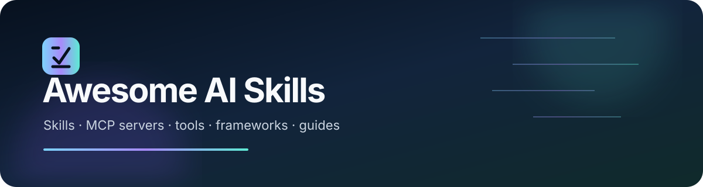

### [Explore the searchable website →](https://zac10ck.github.io/awesome-ai-skills/)

Search resources, filter by category and type, and save your favorites.

### The open directory for discovering practical AI capabilities

Find the right skill, server, framework, or guide without searching across dozens of disconnected ecosystems.

[Browse Directory](#browse-by-category) · [Agent Skills](#agent-skills) · [MCP Servers](#mcp-servers) · [Creative AI](#video-generation) · [Testing](#software-testing) · [Contribute](CONTRIBUTING.md)

Awesome AI Skills is a community-curated directory for developers, designers, researchers, creators, operators, students, and teams building with AI. Every entry is typed and categorized so you can tell an installable Agent Skill from an MCP server, framework, application, or reference before following the link.

> If this directory saves you time, [star the repository](https://github.com/Zac10ck/awesome-ai-skills) and help improve it by [suggesting a resource](https://github.com/Zac10ck/awesome-ai-skills/issues/new?template=add-resource.yml).

## Contents

- [Browse by category](#browse-by-category)
- [Featured collection](#featured-collection)
- [Explore the directory](#explore-the-directory)
- [How resources are selected](#how-resources-are-selected)
- [Using this catalog](#using-this-catalog)
- [Contributing](#contributing)
- [License](#license)

## Browse by category

**Industry workflows:** [Trading research](#trading-research) · [Finance & accounting](#finance-accounting) · [Healthcare & life sciences](#healthcare-ai) · [Organization & team operations](#organization-work) · [Blogs & discovery](#blogs-research)

Trading entries support research and historical evaluation; they do not establish future profitability. Healthcare entries support research and development; clinical suitability requires independent assessment.

| Build | Create | Operate | Learn & Work |
|---|---|---|---|
| [Agent Skills](#agent-skills) | [Video, Motion & 3D](#video-generation) | [MCP Servers](#mcp-servers) | [Research & Knowledge](#research-knowledge) |
| [Programming Languages](#programming-languages) | [Image Generation](#image-generation) | [DevOps & Cloud](#devops-cloud) | [Productivity](#productivity) |
| [Backend & APIs](#backend-api) | [Audio, Voice & Music](#audio-music) | [Cybersecurity](#cybersecurity) | [Education](#education) |
| [Testing & Quality](#software-testing) | [Frontend & UI/UX](#frontend-design) | [Automation](#automation-integration) | [Business & Marketing](#business-marketing) |
| [Databases & Search](#databases) | [Content & Creative](#content-creative) | [Data & Analytics](#data-analytics) | [Design Guides](#design-guides) |

### Know what you are installing

| Resource type | What it gives you |
|---|---|
| **Agent Skill** | Reusable instructions, scripts, and domain knowledge loaded by a compatible AI agent. |
| **MCP Server** | Tools or data exposed to an AI application through the Model Context Protocol. |
| **Framework / SDK** | Building blocks for creating applications, agents, media, tests, or integrations. |
| **Tool / App** | A usable application, command-line utility, or hosted platform. |
| **Guide** | Documentation and standards to learn from; nothing to install. |

## Featured collection

### Top 10 Claude Frontend Design Skills & MCP Servers

*An essential toolkit for building excellent user interfaces with Claude Code.*

This is an editorial starting set, not an objective ranking. Compatibility is only listed where the project's own documentation supports it. See the [full collection](collections/frontend-design.md) for notes and installation links.

1. [frontend-design](https://github.com/anthropics/skills/tree/main/skills/frontend-design)
2. [ui-ux-pro-max](https://github.com/nextlevelbuilder/ui-ux-pro-max-skill)
3. [design-taste-frontend](https://github.com/Leonxlnx/taste-skill)
4. [shadcn-ui-mcp-server](https://github.com/Jpisnice/shadcn-ui-mcp-server)
5. [21st.dev Magic MCP](https://github.com/21st-dev/magic-mcp)
6. [vercel-react-best-practices](https://github.com/vercel-labs/agent-skills/tree/main/skills/react-best-practices)
7. [GSAP Skills](https://github.com/greensock/gsap-skills)
8. [motion-framer](https://github.com/freshtechbro/claudedesignskills/tree/main/.claude/skills/motion-framer)
9. [convex-create-component](https://github.com/get-convex/agent-skills)
10. [vercel-react-native-skills](https://github.com/vercel-labs/agent-skills/tree/main/skills/react-native-skills)

### Curated paths

| Collection | Best for | Start here |
|---|---|---|
| **Frontend design** | Polished interfaces, accessibility, React, motion, and design systems | [Open collection](collections/frontend-design.md) |
| **MCP essentials** | Choosing secure, useful servers and learning the protocol | [Open collection](collections/mcp-essentials.md) |
| **Software testing** | Unit, browser, API, accessibility, integration, and load testing | [Open collection](collections/software-testing.md) |
| **Video & creative coding** | Programmatic video, editing, generation, animation, and 3D | [Open collection](collections/video-creative.md) |
| **Programming foundations** | Languages, backends, databases, and developer tooling | [Open collection](collections/programming.md) |

<!-- CATALOG:START -->

## Explore the directory

| Category | Resources |
|---|---:|
| [Agent Skills](#agent-skills) | 13 |
| [MCP Servers](#mcp-servers) | 20 |
| [Frontend & UI/UX](#frontend-design) | 9 |
| [Software Engineering](#software-engineering) | 5 |
| [DevOps, Cloud & Infrastructure](#devops-cloud) | 8 |
| [Cybersecurity](#cybersecurity) | 4 |
| [Research & Knowledge](#research-knowledge) | 6 |
| [Productivity & Personal Workflows](#productivity) | 3 |
| [Content & Creative Work](#content-creative) | 2 |
| [Video, Motion & 3D](#video-generation) | 8 |
| [Image Generation & Visual Media](#image-generation) | 6 |
| [Audio, Voice & Music](#audio-music) | 6 |
| [Business, Marketing & Sales](#business-marketing) | 4 |
| [Data Science & Analytics](#data-analytics) | 4 |
| [Software Testing & Quality](#software-testing) | 8 |
| [Programming Languages & SDKs](#programming-languages) | 8 |
| [Databases, Storage & Search](#databases) | 8 |
| [Automation & Integrations](#automation-integration) | 6 |
| [Backend, APIs & Full Stack](#backend-api) | 7 |
| [AI Agent Development](#agent-development) | 13 |
| [Education & Learning](#education) | 4 |
| [Specialized Industries](#specialized-industries) | 6 |
| [AI Ecosystem Resources](#ecosystem) | 9 |
| [Design Guides](#design-guides) | 5 |
| [Trading & Quantitative Research](#trading-research) | 7 |
| [Finance & Accounting](#finance-accounting) | 5 |
| [Healthcare & Life Sciences](#healthcare-ai) | 5 |
| [Organization & Team Operations](#organization-work) | 7 |
| [Blogs, Research & Discovery](#blogs-research) | 9 |

### Agent Skills

Reusable instructions and capabilities for AI coding and general-purpose agents.

| Name | Type | Description | Compatibility | Link |
|---|---|---|---|---|
| Agent Skills Specification | documentation | Open specification describing the portable Agent Skills folder and SKILL.md format. | Agent Skills clients | [Visit](https://agentskills.io/specification) |
| Anthropic Skills | skill-collection | Official collection of example and production skills for Claude products and compatible agents. | Claude Code, Claude.ai | [Visit](https://github.com/anthropics/skills) |
| awesome-copilot | skill-collection | GitHub-maintained community catalog of Copilot instructions, prompts, agents, and skills. | GitHub Copilot | [Visit](https://github.com/github/awesome-copilot) |
| Azure Agent Skills | skill-collection | Microsoft-maintained skills for planning, deploying, operating, and optimizing workloads on Azure. | Agent Skills clients | [Visit](https://github.com/microsoft/azure-skills) |
| Cloudflare Agent Skills | skill-collection | Official Cloudflare skills covering Workers, Durable Objects, performance, security, and platform tooling. | Agent Skills clients | [Visit](https://github.com/cloudflare/skills) |
| Cursor Rules | documentation | Official Cursor documentation for persistent project instructions and reusable agent guidance. | Cursor | [Visit](https://cursor.com/docs/rules) |
| Expo Skills | skill-collection | Expo-maintained skills for building, reviewing, and improving React Native applications. | Agent Skills clients | [Visit](https://github.com/expo/skills) |
| Firebase Agent Skills | skill-collection | Official Firebase skills for authentication, Firestore, hosting, security rules, Genkit, and app development. | Agent Skills clients | [Visit](https://github.com/firebase/agent-skills) |
| Gemini CLI Extensions | documentation | Official documentation for packaging prompts, MCP servers, skills, and configuration as Gemini CLI extensions. | Gemini CLI | [Visit](https://github.com/google-gemini/gemini-cli/blob/main/docs/extensions/index.md) |
| OpenAI Skills | skill-collection | OpenAI's public collection of reusable skills for Codex and agent workflows. | Codex | [Visit](https://github.com/openai/skills) |
| OpenCode Agents | documentation | Official OpenCode documentation for configuring specialized primary agents and subagents. | OpenCode | [Visit](https://opencode.ai/docs/agents/) |
| Stripe AI Skills | skill-collection | Official Stripe resources and skills for integrating, upgrading, and operating Stripe-powered applications. | Agent Skills clients | [Visit](https://github.com/stripe/ai) |
| Supabase Agent Skills | skill-collection | Supabase-maintained agent skills for PostgreSQL design, security, performance, and platform workflows. | Agent Skills clients | [Visit](https://github.com/supabase/agent-skills) |

[Back to directory ↑](#explore-the-directory)

### MCP Servers

Servers that expose tools and context through the Model Context Protocol.

| Name | Type | Description | Compatibility | Link |
|---|---|---|---|---|
| AWS MCP Servers | mcp-server | AWS Labs collection of specialized MCP servers for AWS services and cloud development. | MCP clients | [Visit](https://github.com/awslabs/mcp) |
| Azure MCP Server | mcp-server | Microsoft's official MCP server for working with supported Azure services and resources. | MCP clients | [Visit](https://github.com/microsoft/mcp/tree/main/servers/Azure.Mcp.Server) |
| Blender MCP | mcp-server | Community MCP integration that lets compatible agents control Blender scenes, objects, and rendering workflows. | MCP clients, Blender | [Visit](https://github.com/ahujasid/blender-mcp) |
| Cloudflare MCP Servers | mcp-server | Cloudflare-maintained MCP servers for documentation, observability, bindings, and platform operations. | MCP clients | [Visit](https://github.com/cloudflare/mcp-server-cloudflare) |
| Context7 MCP | mcp-server | Upstash-maintained MCP server that supplies current, version-specific library documentation. | MCP clients | [Visit](https://github.com/upstash/context7) |
| Figma Context MCP | mcp-server | Community MCP server that provides design context from Figma files to AI coding agents. | MCP clients, Figma | [Visit](https://github.com/GLips/Figma-Context-MCP) |
| Firecrawl MCP Server | mcp-server | Official Firecrawl MCP server for web search, crawling, extraction, and structured research workflows. | MCP clients | [Visit](https://github.com/mendableai/firecrawl-mcp-server) |
| GitHub MCP Server | mcp-server | GitHub's official MCP server for repository, issue, pull request, code, and workflow operations. | MCP clients | [Visit](https://github.com/github/github-mcp-server) |
| MCP Inspector | ai-tool | Official interactive developer tool for testing and debugging MCP servers and protocol exchanges. | MCP | [Visit](https://github.com/modelcontextprotocol/inspector) |
| MCP Python SDK | mcp-sdk | Official Python SDK for implementing Model Context Protocol clients and servers. | Python | [Visit](https://github.com/modelcontextprotocol/python-sdk) |
| MCP Reference Servers | skill-collection | Official reference implementations demonstrating core Model Context Protocol server patterns. | MCP clients | [Visit](https://github.com/modelcontextprotocol/servers) |
| MCP TypeScript SDK | mcp-sdk | Official TypeScript SDK for building Model Context Protocol clients and servers. | TypeScript | [Visit](https://github.com/modelcontextprotocol/typescript-sdk) |
| Model Context Protocol | documentation | Official protocol documentation for connecting AI applications to tools and external data. | MCP | [Visit](https://modelcontextprotocol.io/docs/2026-07-28/getting-started/intro) |
| Notion MCP Server | mcp-server | Official Notion MCP server for connecting AI tools to pages, databases, and workspace content. | MCP clients | [Visit](https://github.com/makenotion/notion-mcp-server) |
| Playwright MCP | mcp-server | Microsoft's official browser automation MCP server built on Playwright's accessibility model. | MCP clients | [Visit](https://github.com/microsoft/playwright-mcp) |
| Postgres MCP Pro | mcp-server | Community PostgreSQL MCP server with database inspection, analysis, and performance tooling. | MCP clients | [Visit](https://github.com/crystaldba/postgres-mcp) |
| Sentry MCP Server | mcp-server | Official Sentry MCP server for investigating application errors, issues, projects, and observability data. | MCP clients | [Visit](https://github.com/getsentry/sentry-mcp) |
| Sequential Thinking | mcp-server | Reference MCP server offering a structured tool for dynamic, reflective problem-solving sequences. | MCP clients | [Visit](https://github.com/modelcontextprotocol/servers/tree/main/src/sequentialthinking) |
| Stripe Agent Toolkit | mcp-server | Official Stripe toolkit exposing payment and business operations to supported AI agents and MCP clients. | MCP clients, Python, TypeScript | [Visit](https://github.com/stripe/agent-toolkit) |
| Supabase MCP Server | mcp-server | Official community-maintained Supabase server for database, project, migration, and development workflows. | MCP clients | [Visit](https://github.com/supabase-community/supabase-mcp) |

[Back to directory ↑](#explore-the-directory)

### Frontend & UI/UX

Skills, tools, and guidance for interface design and frontend development.

| Name | Type | Description | Compatibility | Link |
|---|---|---|---|---|
| 21st.dev Magic MCP | mcp-server | MCP server from 21st.dev for generating and discovering polished user-interface components. | MCP clients | [Visit](https://github.com/21st-dev/magic-mcp) |
| design-taste-frontend | agent-skill | Opinionated frontend design skill focused on visual craft and avoiding generic generated interfaces. | Claude Code | [Visit](https://github.com/Leonxlnx/taste-skill) |
| frontend-design | agent-skill | Anthropic's official skill for creating distinctive, production-quality frontend interfaces. | Claude Code, Claude.ai | [Visit](https://github.com/anthropics/skills/tree/main/skills/frontend-design) |
| GSAP Skills | skill-collection | Official GreenSock skill collection for creating and optimizing GSAP web animations. | Agent Skills clients | [Visit](https://github.com/greensock/gsap-skills) |
| motion-framer | agent-skill | Community skill with practical patterns for building interface animation using Motion for React. | Claude Code | [Visit](https://github.com/freshtechbro/claudedesignskills/tree/main/.claude/skills/motion-framer) |
| shadcn-ui-mcp-server | mcp-server | Community MCP server for browsing and working with shadcn/ui components and registries. | MCP clients | [Visit](https://github.com/Jpisnice/shadcn-ui-mcp-server) |
| ui-ux-pro-max | agent-skill | Community design intelligence skill covering styles, palettes, typography, charts, and UI stacks. | Claude Code, Codex, Cursor | [Visit](https://github.com/nextlevelbuilder/ui-ux-pro-max-skill) |
| vercel-react-best-practices | agent-skill | Vercel-maintained guidance for React and Next.js performance patterns used by coding agents. | Agent Skills clients | [Visit](https://github.com/vercel-labs/agent-skills/tree/main/skills/react-best-practices) |
| vercel-react-native-skills | agent-skill | Vercel-maintained best practices for performant React Native and Expo applications. | Agent Skills clients | [Visit](https://github.com/vercel-labs/agent-skills/tree/main/skills/react-native-skills) |

[Back to directory ↑](#explore-the-directory)

### Software Engineering

Development, review, testing, architecture, and maintenance resources.

| Name | Type | Description | Compatibility | Link |
|---|---|---|---|---|
| Aider | ai-tool | Open-source terminal pair programmer that edits local Git repositories with language models. | CLI | [Visit](https://github.com/Aider-AI/aider) |
| Continue | ai-tool | Open-source coding assistant platform for IDE chat, edits, autocomplete, and custom models. | VS Code, JetBrains | [Visit](https://github.com/continuedev/continue) |
| convex-create-component | agent-skill | Convex-maintained skill for building reusable components with isolated schemas and APIs. | Agent Skills clients | [Visit](https://github.com/get-convex/agent-skills) |
| OpenHands | open-source-app | Open-source platform for software-development agents that can edit code and run tools. | — | [Visit](https://github.com/All-Hands-AI/OpenHands) |
| SWE-agent | framework | Princeton research project for agents that resolve issues in real GitHub repositories. | Python | [Visit](https://github.com/SWE-agent/SWE-agent) |

[Back to directory ↑](#explore-the-directory)

### DevOps, Cloud & Infrastructure

Deployment, operations, observability, cloud, and infrastructure resources.

| Name | Type | Description | Compatibility | Link |
|---|---|---|---|---|
| Ansible | open-source-app | Agentless automation system for configuration management, deployment, and orchestration. | Python | [Visit](https://github.com/ansible/ansible) |
| Backstage | platform | CNCF framework for building internal developer portals and managing software catalogs. | — | [Visit](https://github.com/backstage/backstage) |
| Docker Agent | documentation | Official documentation for Docker's open-source framework for defining and running teams of AI agents. | Docker | [Visit](https://docs.docker.com/ai/docker-agent/) |
| Grafana | open-source-app | Open-source platform for querying, visualizing, and alerting on operational data. | — | [Visit](https://github.com/grafana/grafana) |
| Kubernetes | open-source-app | Open-source system for automating deployment, scaling, and management of containerized applications. | — | [Visit](https://github.com/kubernetes/kubernetes) |
| OpenTelemetry | framework | Vendor-neutral observability framework for generating and collecting traces, metrics, and logs. | — | [Visit](https://github.com/open-telemetry/opentelemetry-specification) |
| OpenTofu | open-source-app | Linux Foundation infrastructure-as-code tool and open-source Terraform-compatible alternative. | — | [Visit](https://github.com/opentofu/opentofu) |
| Prometheus | open-source-app | Cloud Native Computing Foundation monitoring system and time-series database. | — | [Visit](https://github.com/prometheus/prometheus) |

[Back to directory ↑](#explore-the-directory)

### Cybersecurity

Defensive security, secure development, auditing, and compliance resources.

| Name | Type | Description | Compatibility | Link |
|---|---|---|---|---|
| OSV-Scanner | ai-tool | Google's scanner for vulnerabilities in project dependencies using the Open Source Vulnerabilities database. | CLI, CI | [Visit](https://github.com/google/osv-scanner) |
| OWASP Top 10 | guide | Widely used awareness document covering the most critical security risks to web applications. | — | [Visit](https://owasp.org/projects/top-ten) |
| Semgrep | ai-tool | Static analysis platform for finding security and correctness issues with customizable rules. | CLI, CI | [Visit](https://github.com/semgrep/semgrep) |
| Trivy | ai-tool | Aqua Security scanner for vulnerabilities, misconfigurations, secrets, licenses, and supply chains. | CLI, CI | [Visit](https://github.com/aquasecurity/trivy) |

[Back to directory ↑](#explore-the-directory)

### Research & Knowledge

Research, retrieval, citations, knowledge management, and fact-checking tools.

| Name | Type | Description | Compatibility | Link |
|---|---|---|---|---|
| Crossref REST API | documentation | Public API for querying DOI metadata and scholarly publishing records from Crossref. | — | [Visit](https://www.crossref.org/documentation/retrieve-metadata/rest-api/) |
| OpenAlex | platform | Open catalog of scholarly works, authors, institutions, topics, and citation relationships. | — | [Visit](https://openalex.org/) |
| Semantic Scholar API | documentation | Official API documentation for programmatic access to scholarly paper and citation data. | — | [Visit](https://api.semanticscholar.org/api-docs/) |
| Unpaywall | platform | Open database and API for locating legally available open-access scholarly articles. | — | [Visit](https://unpaywall.org/products/api) |
| Wikidata | platform | Collaboratively maintained open knowledge base with structured, queryable entities and relationships. | — | [Visit](https://www.wikidata.org/wiki/Wikidata:Introduction) |
| Zotero | open-source-app | Open-source research assistant for collecting, organizing, citing, and sharing sources. | — | [Visit](https://github.com/zotero/zotero) |

[Back to directory ↑](#explore-the-directory)

### Productivity & Personal Workflows

Documents, scheduling, notes, communication, and workflow automation.

| Name | Type | Description | Compatibility | Link |
|---|---|---|---|---|
| n8n | open-source-app | Source-available workflow automation platform with integrations and AI workflow building blocks. | — | [Visit](https://github.com/n8n-io/n8n) |
| Obsidian Help | documentation | Official documentation for the local-first note-taking and personal knowledge-management application. | Obsidian | [Visit](https://help.obsidian.md/) |
| Paperless-ngx | open-source-app | Community document-management system for indexing, searching, and organizing scanned documents. | — | [Visit](https://github.com/paperless-ngx/paperless-ngx) |

[Back to directory ↑](#explore-the-directory)

### Content & Creative Work

Writing, media generation, design, and creative automation resources.

| Name | Type | Description | Compatibility | Link |
|---|---|---|---|---|
| ComfyUI | open-source-app | Node-based graphical interface and inference engine for composable generative-media workflows. | — | [Visit](https://github.com/Comfy-Org/ComfyUI) |
| Diffusers | library | Hugging Face library providing pretrained diffusion models for image, video, and audio generation. | Python | [Visit](https://github.com/huggingface/diffusers) |

[Back to directory ↑](#explore-the-directory)

### Video, Motion & 3D

Video generation, editing, compositing, motion graphics, avatars, and 3D creative workflows.

| Name | Type | Description | Compatibility | Link |
|---|---|---|---|---|
| Blender | open-source-app | Open-source 3D creation suite for modeling, animation, simulation, compositing, and video editing. | — | [Visit](https://github.com/blender/blender) |
| FFmpeg | open-source-app | Cross-platform toolkit for recording, converting, filtering, streaming, and processing multimedia. | — | [Visit](https://github.com/FFmpeg/FFmpeg) |
| Kdenlive | open-source-app | KDE's open-source non-linear video editor for multitrack editing, effects, titles, and proxy workflows. | — | [Visit](https://invent.kde.org/multimedia/kdenlive) |
| MoviePy | library | Python library for scripted video editing, compositing, transformations, titles, and audio mixing. | Python | [Visit](https://github.com/Zulko/moviepy) |
| Remotion | framework | React framework for creating programmatic videos, compositions, captions, and rendering pipelines. | React, TypeScript | [Visit](https://github.com/remotion-dev/remotion) |
| Remotion Agent Skills | skill-collection | Official Remotion skills for creating, rendering, captioning, and structuring programmatic videos. | Agent Skills clients | [Visit](https://github.com/remotion-dev/skills) |
| Shotcut | open-source-app | Cross-platform open-source video editor with timeline, filters, transitions, and broad format support. | — | [Visit](https://github.com/mltframework/shotcut) |
| Wan Video | framework | Open-source video generation models and inference code from Alibaba's Wan research team. | Python | [Visit](https://github.com/Wan-Video/Wan2.1) |

[Back to directory ↑](#explore-the-directory)

### Image Generation & Visual Media

Image generation, editing, upscaling, visual pipelines, and creative model tooling.

| Name | Type | Description | Compatibility | Link |
|---|---|---|---|---|
| FLUX | framework | Official inference code and model resources for Black Forest Labs' FLUX image generation models. | Python | [Visit](https://github.com/black-forest-labs/flux) |
| InvokeAI | open-source-app | Creative engine for Stable Diffusion models with canvas, workflow, gallery, and generation tooling. | Python | [Visit](https://github.com/invoke-ai/InvokeAI) |
| Krita AI Diffusion | ai-tool | Krita plugin for generative fill, upscaling, control workflows, and local diffusion-based editing. | Krita | [Visit](https://github.com/Acly/krita-ai-diffusion) |
| Real-ESRGAN | framework | Open-source restoration framework for practical image and video super-resolution and enhancement. | Python | [Visit](https://github.com/xinntao/Real-ESRGAN) |
| Segment Anything | framework | Meta AI research models and code for promptable object segmentation in images. | Python | [Visit](https://github.com/facebookresearch/segment-anything) |
| Stable Diffusion Web UI | open-source-app | Community web interface for Stable Diffusion generation, editing, extensions, and model workflows. | Python | [Visit](https://github.com/AUTOMATIC1111/stable-diffusion-webui) |

[Back to directory ↑](#explore-the-directory)

### Audio, Voice & Music

Speech, transcription, voice synthesis, music generation, and audio production resources.

| Name | Type | Description | Compatibility | Link |
|---|---|---|---|---|
| Audacity | open-source-app | Cross-platform multi-track audio editor and recorder for editing, cleanup, effects, and export. | — | [Visit](https://github.com/audacity/audacity) |
| AudioCraft | framework | Meta research library for audio and music generation models including MusicGen and AudioGen. | Python | [Visit](https://github.com/facebookresearch/audiocraft) |
| Coqui TTS | framework | Deep-learning toolkit for training and running text-to-speech and voice synthesis models. | Python | [Visit](https://github.com/coqui-ai/TTS) |
| faster-whisper | library | CTranslate2 implementation of Whisper optimized for faster and lower-memory transcription. | Python | [Visit](https://github.com/SYSTRAN/faster-whisper) |
| MuseScore | open-source-app | Open-source music notation and composition application with playback, engraving, and export tools. | — | [Visit](https://github.com/musescore/MuseScore) |
| Whisper | framework | OpenAI's open-source neural speech recognition model and transcription toolkit. | Python | [Visit](https://github.com/openai/whisper) |

[Back to directory ↑](#explore-the-directory)

### Business, Marketing & Sales

Customer, market, sales, support, and business operations tools.

| Name | Type | Description | Compatibility | Link |
|---|---|---|---|---|
| Chatwoot | open-source-app | Open-source customer engagement platform for support inboxes, automation, and messaging channels. | — | [Visit](https://github.com/chatwoot/chatwoot) |
| ERPNext | open-source-app | Open-source enterprise resource planning suite for finance, sales, inventory, and operations. | — | [Visit](https://github.com/frappe/erpnext) |
| Mautic | open-source-app | Open-source marketing automation platform for campaigns, contacts, email, and segmentation. | — | [Visit](https://github.com/mautic/mautic) |
| Metabase | open-source-app | Open-source business intelligence platform for questions, dashboards, and embedded analytics. | — | [Visit](https://github.com/metabase/metabase) |

[Back to directory ↑](#explore-the-directory)

### Data Science & Analytics

Analysis, visualization, machine learning, data engineering, and BI resources.

| Name | Type | Description | Compatibility | Link |
|---|---|---|---|---|
| Apache Superset | open-source-app | Apache's open-source platform for data exploration, visualization, and business intelligence. | — | [Visit](https://github.com/apache/superset) |
| DuckDB | open-source-app | In-process analytical SQL database suited to local analysis and data engineering workflows. | — | [Visit](https://github.com/duckdb/duckdb) |
| Jupyter AI | ai-tool | JupyterLab extension and Python package for generative-AI assistance in notebook workflows. | JupyterLab | [Visit](https://github.com/jupyterlab/jupyter-ai) |
| Polars | library | Fast DataFrame library written in Rust with bindings for Python and other languages. | Python, Rust | [Visit](https://github.com/pola-rs/polars) |

[Back to directory ↑](#explore-the-directory)

### Software Testing & Quality

Unit, integration, end-to-end, load, accessibility, API, and AI-system testing resources.

| Name | Type | Description | Compatibility | Link |
|---|---|---|---|---|
| axe-core | library | Deque's accessibility testing engine for automated checks in browsers and testing frameworks. | JavaScript | [Visit](https://github.com/dequelabs/axe-core) |
| Cypress | framework | JavaScript testing framework for browser end-to-end, component, integration, and API testing. | JavaScript, TypeScript | [Visit](https://github.com/cypress-io/cypress) |
| Grafana k6 | ai-tool | Developer-focused load and performance testing tool for APIs, websites, and distributed systems. | JavaScript, CLI | [Visit](https://github.com/grafana/k6) |
| Playwright | framework | Microsoft's cross-browser end-to-end testing and automation framework for modern web applications. | TypeScript, Python, Java, .NET | [Visit](https://github.com/microsoft/playwright) |
| pytest | framework | Mature Python testing framework with concise fixtures, parametrization, plugins, and rich failure output. | Python | [Visit](https://github.com/pytest-dev/pytest) |
| Schemathesis | framework | Property-based API testing tool that generates checks from OpenAPI and GraphQL schemas. | Python, CLI | [Visit](https://github.com/schemathesis/schemathesis) |
| Testcontainers | framework | Libraries for integration tests using lightweight, disposable containers for databases and services. | Java | [Visit](https://github.com/testcontainers/testcontainers-java) |
| Vitest | framework | Vite-native unit testing framework with TypeScript, ESM, mocking, coverage, and workspace support. | JavaScript, TypeScript | [Visit](https://github.com/vitest-dev/vitest) |

[Back to directory ↑](#explore-the-directory)

### Programming Languages & SDKs

Language ecosystems, runtimes, SDKs, package tooling, and programming references.

| Name | Type | Description | Compatibility | Link |
|---|---|---|---|---|
| .NET | framework | Microsoft's cross-platform runtime, SDK, and libraries for building .NET applications. | C#, F#, Visual Basic | [Visit](https://github.com/dotnet/runtime) |
| Go | documentation | Official source, documentation, and tooling for the Go programming language. | Go | [Visit](https://github.com/golang/go) |
| Kotlin | documentation | Official Kotlin language repository for JVM, Android, JavaScript, WebAssembly, and native development. | Kotlin | [Visit](https://github.com/JetBrains/kotlin) |
| Node.js | framework | Cross-platform JavaScript runtime for servers, tools, command-line applications, and automation. | JavaScript, TypeScript | [Visit](https://github.com/nodejs/node) |
| Python | documentation | Official documentation, tutorials, language reference, and standard library for Python. | Python | [Visit](https://docs.python.org/3/) |
| Rust | documentation | Official Rust language repository and gateway to its compiler, standard library, and documentation. | Rust | [Visit](https://github.com/rust-lang/rust) |
| Swift | documentation | Official Swift programming language and standard library for Apple platforms and servers. | Swift | [Visit](https://github.com/swiftlang/swift) |
| TypeScript | documentation | Official TypeScript language, compiler, handbook, and tooling repository from Microsoft. | TypeScript | [Visit](https://github.com/microsoft/TypeScript) |

[Back to directory ↑](#explore-the-directory)

### Databases, Storage & Search

Relational, document, vector, search, caching, and data-platform resources.

| Name | Type | Description | Compatibility | Link |
|---|---|---|---|---|
| Chroma | open-source-app | Open-source embedding database focused on local and application-level AI retrieval workflows. | Python, JavaScript | [Visit](https://github.com/chroma-core/chroma) |
| Elasticsearch | open-source-app | Distributed search and analytics engine for full-text search, observability, and structured data. | — | [Visit](https://github.com/elastic/elasticsearch) |
| Milvus | open-source-app | Cloud-native vector database for similarity search and large-scale AI retrieval workloads. | — | [Visit](https://github.com/milvus-io/milvus) |
| MongoDB | open-source-app | Document database platform with flexible JSON-like data models, indexing, and distributed operation. | — | [Visit](https://github.com/mongodb/mongo) |
| PostgreSQL | open-source-app | Advanced open-source relational database with extensibility, transactions, JSON, and rich SQL support. | — | [Visit](https://www.postgresql.org/) |
| Redis | open-source-app | In-memory data store for caching, queues, streams, vector search, and real-time applications. | — | [Visit](https://github.com/redis/redis) |
| SQLite | library | Small, self-contained transactional SQL database engine embedded in applications and tools. | — | [Visit](https://www.sqlite.org/) |
| Weaviate | open-source-app | Open-source vector database supporting semantic search, hybrid retrieval, and generative integrations. | — | [Visit](https://github.com/weaviate/weaviate) |

[Back to directory ↑](#explore-the-directory)

### Automation & Integrations

Workflow automation, browser control, integration platforms, and event-driven tooling.

| Name | Type | Description | Compatibility | Link |
|---|---|---|---|---|
| Activepieces | open-source-app | Open-source automation platform for building human and AI workflows across apps and services. | — | [Visit](https://github.com/activepieces/activepieces) |
| Browser Use | framework | Open-source framework for enabling AI agents to navigate and interact with websites in a browser. | Python | [Visit](https://github.com/browser-use/browser-use) |
| Huginn | open-source-app | Self-hosted system for creating agents that monitor events and automate actions across the web. | — | [Visit](https://github.com/huginn/huginn) |
| Kestra | open-source-app | Event-driven orchestration platform for declarative data, infrastructure, and business workflows. | — | [Visit](https://github.com/kestra-io/kestra) |
| Stagehand | framework | Browserbase framework combining browser automation code with natural-language AI actions and extraction. | TypeScript, Python | [Visit](https://github.com/browserbase/stagehand) |
| Windmill | open-source-app | Open-source workflow engine and developer platform for scripts, flows, apps, and scheduled jobs. | — | [Visit](https://github.com/windmill-labs/windmill) |

[Back to directory ↑](#explore-the-directory)

### Backend, APIs & Full Stack

Backend frameworks, API development, authentication, real-time systems, and full-stack platforms.

| Name | Type | Description | Compatibility | Link |
|---|---|---|---|---|
| Appwrite | open-source-app | Open-source backend platform providing authentication, databases, storage, functions, and messaging APIs. | — | [Visit](https://github.com/appwrite/appwrite) |
| Directus | open-source-app | Data platform providing instant REST and GraphQL APIs, authentication, automation, and an admin application. | — | [Visit](https://github.com/directus/directus) |
| Django | framework | Batteries-included Python web framework with ORM, authentication, administration, and security tooling. | Python | [Visit](https://github.com/django/django) |
| FastAPI | framework | Modern Python framework for high-performance APIs with type hints and automatic OpenAPI documentation. | Python | [Visit](https://github.com/fastapi/fastapi) |
| NestJS | framework | Progressive Node.js framework for structured, scalable server-side TypeScript applications. | TypeScript | [Visit](https://github.com/nestjs/nest) |
| PocketBase | open-source-app | Single-file open-source backend with embedded database, authentication, files, and real-time subscriptions. | Go, JavaScript | [Visit](https://github.com/pocketbase/pocketbase) |
| Spring Boot | framework | Spring framework for production Java services with opinionated configuration and operational features. | Java, Kotlin | [Visit](https://github.com/spring-projects/spring-boot) |

[Back to directory ↑](#explore-the-directory)

### AI Agent Development

Frameworks and infrastructure for building, evaluating, and operating agents.

| Name | Type | Description | Compatibility | Link |
|---|---|---|---|---|
| CrewAI | framework | Open-source Python framework for coordinating role-based AI agents, crews, and flows. | Python | [Visit](https://github.com/crewAIInc/crewAI) |
| DSPy | framework | Stanford framework for programming and optimizing modular language-model applications. | Python | [Visit](https://github.com/stanfordnlp/dspy) |
| Haystack | framework | deepset's open-source Python framework for production retrieval, pipelines, and agent systems. | Python | [Visit](https://github.com/deepset-ai/haystack) |
| Langfuse | open-source-app | Open-source platform for tracing, evaluating, and monitoring language-model applications. | — | [Visit](https://github.com/langfuse/langfuse) |
| LangGraph | framework | LangChain framework for building controllable, stateful, long-running agent workflows. | Python, JavaScript | [Visit](https://github.com/langchain-ai/langgraph) |
| LlamaIndex | framework | Framework for context-augmented applications using documents, retrieval, workflows, and agents. | Python, TypeScript | [Visit](https://github.com/run-llama/llama_index) |
| Mem0 | library | Open-source memory layer for personalizing AI agents and retaining useful cross-session context. | Python, JavaScript | [Visit](https://github.com/mem0ai/mem0) |
| Microsoft Agent Framework | framework | Microsoft framework for building and orchestrating single-agent and multi-agent applications. | Python, .NET | [Visit](https://github.com/microsoft/agent-framework) |
| OpenAI Agents SDK for Python | framework | OpenAI's lightweight Python framework for tool-using agents, handoffs, guardrails, and tracing. | Python | [Visit](https://github.com/openai/openai-agents-python) |
| Promptfoo | ai-tool | Open-source command-line and library tooling for evaluating prompts, models, and agent security. | Node.js | [Visit](https://github.com/promptfoo/promptfoo) |
| Pydantic AI | framework | Pydantic's Python agent framework emphasizing typed dependencies, structured output, and testing. | Python | [Visit](https://github.com/pydantic/pydantic-ai) |
| Qdrant | open-source-app | Open-source vector search engine and database designed for filtering and similarity retrieval. | — | [Visit](https://github.com/qdrant/qdrant) |
| Semantic Kernel | framework | Microsoft SDK for integrating models, plugins, memory, and agent orchestration into applications. | Python, .NET, Java | [Visit](https://github.com/microsoft/semantic-kernel) |

[Back to directory ↑](#explore-the-directory)

### Education & Learning

Tutoring, study, courseware, and educational creation resources.

| Name | Type | Description | Compatibility | Link |
|---|---|---|---|---|
| freeCodeCamp | platform | Nonprofit learning platform with free programming curricula, projects, and certifications. | — | [Visit](https://github.com/freeCodeCamp/freeCodeCamp) |
| Khanmigo | platform | Khan Academy's AI-powered learning and teaching assistant with guided educational workflows. | — | [Visit](https://www.khanmigo.ai/) |
| OpenStax | platform | Nonprofit publisher providing openly licensed textbooks and supporting learning resources. | — | [Visit](https://openstax.org/) |
| The Algorithms | documentation | Community collection of open-source algorithm implementations across many programming languages. | — | [Visit](https://github.com/TheAlgorithms) |

[Back to directory ↑](#explore-the-directory)

### Specialized Industries

Domain-specific resources whose professional limitations should be assessed.

| Name | Type | Description | Compatibility | Link |
|---|---|---|---|---|
| CourtListener | platform | Free Law Project database and APIs for U.S. legal opinions, dockets, and citations; verify legal use. | — | [Visit](https://www.courtlistener.com/) |
| HL7 FHIR | documentation | Healthcare data-exchange specification; implementations require clinical, privacy, and regulatory review. | — | [Visit](https://hl7.org/fhir/) |
| IfcOpenShell | library | Open-source library and tools for working with IFC building information models; validate professional outputs. | Python, C++ | [Visit](https://github.com/IfcOpenShell/IfcOpenShell) |
| OpenBB | platform | Open-source investment research platform; outputs are informational and not financial advice. | Python | [Visit](https://github.com/OpenBB-finance/OpenBB) |
| OpenFOAM | open-source-app | Open-source computational fluid dynamics software requiring appropriate engineering validation and expertise. | — | [Visit](https://github.com/OpenFOAM/OpenFOAM-dev) |
| QGIS | open-source-app | Open-source geographic information system for spatial analysis, mapping, and geospatial workflows. | — | [Visit](https://github.com/qgis/QGIS) |

[Back to directory ↑](#explore-the-directory)

### AI Ecosystem Resources

Directories, registries, documentation, tutorials, and awesome lists.

| Name | Type | Description | Compatibility | Link |
|---|---|---|---|---|
| Awesome Generative AI | awesome-list | Community-curated collection of generative AI research, tools, projects, and learning resources. | — | [Visit](https://github.com/steven2358/awesome-generative-ai) |
| Awesome MCP Servers | awesome-list | Community directory of Model Context Protocol servers grouped by capability and integration. | MCP clients | [Visit](https://github.com/punkpeye/awesome-mcp-servers) |
| Awesome Selfhosted | awesome-list | Community-curated directory of free software network services and web applications for self-hosting. | — | [Visit](https://github.com/awesome-selfhosted/awesome-selfhosted) |
| Awesome Sysadmin | awesome-list | Established curated list of open-source system administration tools and resources. | — | [Visit](https://github.com/awesome-foss/awesome-sysadmin) |
| Hugging Face Spaces | platform | Platform for discovering, publishing, and running interactive machine-learning applications. | — | [Visit](https://huggingface.co/spaces) |
| MCP Registry | mcp-registry | Official Model Context Protocol registry for discovering published MCP servers and metadata. | MCP | [Visit](https://registry.modelcontextprotocol.io/) |
| Ollama | open-source-app | Local model runtime and distribution tool for running supported language and multimodal models. | — | [Visit](https://github.com/ollama/ollama) |
| Open WebUI | open-source-app | Self-hosted extensible interface for interacting with language models and knowledge sources. | — | [Visit](https://github.com/open-webui/open-webui) |
| Skills Directory | platform | Public Agent Skills directory; treat listings as untrusted code and independently inspect every skill before use. | Agent Skills clients | [Visit](https://www.skills.sh/) |

[Back to directory ↑](#explore-the-directory)

### Design Guides

Authoritative interface, platform, and accessibility guidance.

| Name | Type | Description | Compatibility | Link |
|---|---|---|---|---|
| Apple Human Interface Guidelines | guide | Apple's official guidance for consistent, accessible, and intuitive experiences across its platforms. | Apple platforms | [Visit](https://developer.apple.com/design/human-interface-guidelines/) |
| Inclusive Components | guide | Practical patterns for designing and implementing robust, inclusive web interface components. | — | [Visit](https://inclusive-components.design/) |
| Material Design | guide | Google's design system and guidance for building accessible, adaptive digital products. | — | [Visit](https://m3.material.io/) |
| Vercel Web Interface Guidelines | guide | Practical guidance for interactions, animation, layout, content, forms, and web performance. | — | [Visit](https://vercel.com/design/guidelines) |
| Web Content Accessibility Guidelines | guide | W3C's international recommendations for making web content more accessible to people with disabilities. | — | [Visit](https://www.w3.org/WAI/standards-guidelines/wcag/) |

[Back to directory ↑](#explore-the-directory)

### Trading & Quantitative Research

Research, backtesting, and market-data tools. Backtests do not establish future returns.

| Name | Type | Description | Compatibility | Link |
|---|---|---|---|---|
| Backtesting.py | library | Python framework for simulating and analyzing trading strategies on historical data. | — | [Visit](https://github.com/kernc/backtesting.py) |
| FinRL | framework | Reinforcement learning framework for quantitative finance and trading research. | — | [Visit](https://github.com/AI4Finance-Foundation/FinRL) |
| Freqtrade | open-source-app | Crypto strategy research, backtesting, optimization, and trading automation platform. | — | [Visit](https://github.com/freqtrade/freqtrade) |
| LEAN | framework | Open-source algorithmic trading engine for research, backtesting, and execution integrations. | — | [Visit](https://github.com/QuantConnect/Lean) |
| Qlib | framework | Microsoft quantitative investment research platform for data, modeling, and strategy evaluation. | — | [Visit](https://github.com/microsoft/qlib) |
| vectorbt | library | Vectorized Python tools for quantitative strategy exploration and portfolio backtesting. | — | [Visit](https://github.com/polakowo/vectorbt) |
| Zipline | library | Event-driven algorithmic trading backtesting engine and research reference. | — | [Visit](https://github.com/quantopian/zipline) |

[Back to directory ↑](#explore-the-directory)

### Finance & Accounting

Financial language models, accounting, reporting, and financial research resources.

| Name | Type | Description | Compatibility | Link |
|---|---|---|---|---|
| Awesome AI4Finance | awesome-list | Curated financial AI research, models, datasets, and quantitative tooling. | — | [Visit](https://github.com/AI4Finance-Foundation/Awesome_AI4Finance) |
| Beancount | open-source-app | Plain-text double-entry accounting system for programmable financial workflows. | — | [Visit](https://github.com/beancount/beancount) |
| FinGPT | framework | Open-source financial language-model research, datasets, and application examples. | — | [Visit](https://github.com/AI4Finance-Foundation/FinGPT) |
| FinNLP | library | Financial natural-language processing data pipelines and research tooling. | — | [Visit](https://github.com/AI4Finance-Foundation/FinNLP) |
| Frappe Books | open-source-app | Open-source desktop bookkeeping application for small-business accounting. | — | [Visit](https://github.com/frappe/books) |

[Back to directory ↑](#explore-the-directory)

### Healthcare & Life Sciences

Medical AI research and biomedical tooling; inclusion does not establish clinical validation.

| Name | Type | Description | Compatibility | Link |
|---|---|---|---|---|
| DeepChem | framework | Machine-learning framework for molecular, chemical, and life-science research. | — | [Visit](https://github.com/DeepChem/deepchem) |
| MedGemma | framework | Google Health resources and examples for medical multimodal model research. | — | [Visit](https://github.com/google-health/medgemma) |
| MONAI | framework | PyTorch-based toolkit for deep learning research in healthcare imaging. | — | [Visit](https://github.com/Project-MONAI/MONAI) |
| Scanpy | library | Scalable Python toolkit for analyzing single-cell gene expression data. | — | [Visit](https://github.com/scverse/scanpy) |
| TorchIO | library | Tools for loading, preprocessing, augmenting, and sampling medical images. | — | [Visit](https://github.com/TorchIO-project/torchio) |

[Back to directory ↑](#explore-the-directory)

### Organization & Team Operations

Knowledge, project management, team collaboration, and organizational automation.

| Name | Type | Description | Compatibility | Link |
|---|---|---|---|---|
| Dify | open-source-app | Platform for building AI workflows, knowledge applications, and agents. | — | [Visit](https://github.com/langgenius/dify) |
| Docmost | open-source-app | Collaborative documentation and wiki platform for organizational knowledge. | — | [Visit](https://github.com/docmost/docmost) |
| Flowise | open-source-app | Visual tools for composing language-model workflows and agent applications. | — | [Visit](https://github.com/FlowiseAI/Flowise) |
| Onyx | open-source-app | Enterprise AI search and assistant platform connected to organizational knowledge. | — | [Visit](https://github.com/onyx-dot-app/onyx) |
| Outline | open-source-app | Collaborative team knowledge base with search, documents, and integrations. | — | [Visit](https://github.com/outline/outline) |
| Plane | open-source-app | Project management platform for issues, cycles, roadmaps, and team planning. | — | [Visit](https://github.com/makeplane/plane) |
| Twenty | open-source-app | Open-source CRM for organizing customer records, relationships, and team workflows. | — | [Visit](https://github.com/twentyhq/twenty) |

[Back to directory ↑](#explore-the-directory)

### Blogs, Research & Discovery

Primary engineering blogs, research publications, and established curated directories.

| Name | Type | Description | Compatibility | Link |
|---|---|---|---|---|
| Anthropic Engineering | guide | Engineering articles on agents, context, evaluations, and practical AI systems. | — | [Visit](https://www.anthropic.com/engineering) |
| Awesome AI Agents | awesome-list | Community collection of AI agent projects and application examples. | — | [Visit](https://github.com/e2b-dev/awesome-ai-agents) |
| Awesome ChatGPT Prompts | awesome-list | Community prompt examples for writing, productivity, coding, and general assistant tasks. | — | [Visit](https://github.com/f/awesome-chatgpt-prompts) |
| Awesome LLM Apps | awesome-list | Curated example applications for agents, retrieval, multimodal AI, and practical workflows. | — | [Visit](https://github.com/Shubhamsaboo/awesome-llm-apps) |
| Google Research Blog | guide | Primary research announcements and technical articles from Google Research. | — | [Visit](https://research.google/blog/) |
| Hugging Face Blog | guide | Engineering articles, model releases, datasets, and open-source machine-learning tutorials. | — | [Visit](https://huggingface.co/blog) |
| Lilian Weng Blog | guide | Detailed technical literature reviews on machine learning, language models, and agents. | — | [Visit](https://lilianweng.github.io/) |
| Microsoft Research Blog | guide | Research publications and technical perspectives from Microsoft Research. | — | [Visit](https://www.microsoft.com/en-us/research/blog/) |
| Prompt Engineering Guide | guide | Community educational guide to prompting methods, research, and language-model applications. | — | [Visit](https://github.com/dair-ai/Prompt-Engineering-Guide) |

[Back to directory ↑](#explore-the-directory)

<!-- CATALOG:END -->

## How resources are selected

Entries should be useful, directly accessible, clearly described, and attributable to a primary source whenever possible. Inclusion is not an endorsement. We distinguish official resources from community projects and do not infer platform compatibility from a project name.

The catalog records verification and maintenance metadata in [`data/resources.json`](data/resources.json). A missing verification date means the entry still needs a documented link and metadata review.

## Using this catalog

- Browse this README for quick discovery.
- Use [`data/resources.json`](data/resources.json) for machine-readable data.
- Read [Getting Started](docs/getting-started.md) before installing third-party code.
- Review [How to use MCP](docs/how-to-use-mcp.md) for security and configuration basics.

Always inspect third-party source code, requested permissions, install scripts, and license terms before use. Domain-specific tools are not a substitute for qualified professional advice.

## Contributing

Contributions are welcome through a structured [resource request](https://github.com/Zac10ck/awesome-ai-skills/issues/new?template=add-resource.yml) or pull request. Read [CONTRIBUTING.md](CONTRIBUTING.md) for quality criteria and validation steps.

## License

The original curated list content is dedicated to the public domain under [CC0 1.0](LICENSE). Linked projects retain their own licenses, trademarks, and copyrights.
